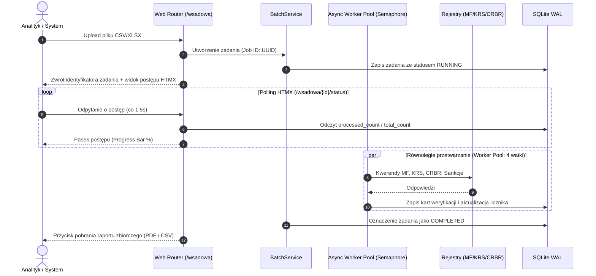

# 🚀 API, Weryfikacja Wsadowa i Formaty Raportów

Niniejszy dokument stanowi specyfikację techniczną interfejsów programistycznych (API), modułu weryfikacji masowej (Batch Processing) oraz formatów eksportu dowodowego.

---

## 🌐 Punkty Końcowe API (API Endpoints)

System udostępnia interfejs HTTP zoptymalizowany pod kątem żądań asynchronicznych (HTMX) oraz bezpośrednich integracji maszynowych:

### 1. Weryfikacja Ad-Hoc (Pojedyncza)
- **`POST /verify`**
  - **Opis:** Uruchamia badanie kontrahenta w rejestrach publicznych i zwraca kartę dowodową (fragment HTML dla HTMX).
  - **Parametry formularza (`application/x-www-form-urlencoded`):**
    - `identifier` *(wymagany)*: NIP (10 cyfr), KRS (10 cyfr), REGON (9/14 cyfr) lub VAT-UE.
    - `rachunek` *(opcjonalny)*: Numer konta bankowego (26 cyfr lub format z odstępami).
    - `kwota` *(opcjonalny)*: Kwota brutto planowanej płatności w PLN (do weryfikacji progu 15 000 zł i Split Payment).
    - `status_pep` *(bool)*: Flaga ręcznego oznaczenia statusu PEP dla osób w podmiocie.
    - `kanal_relacji` *(str)*: `ZDALNIE` (domyślnie) lub `SPOTKANIE_OSOBISTE`.
    - `force` *(bool)*: `true` wymusza pominięcie lokalnego cache i bezpośrednie odpytanie API rządowych.

### 2. Pobieranie Kart Dowodowych i Eksporty
- **`GET /karta/{id}`** — Pełny widok HTML karty audytowej wraz z historią zdarzeń i notatkami analityka.
- **`GET /karta/{id}/pdf`** — Certyfikowany raport audytowy w formacie PDF (A4 pion) z pieczęcią SHA-256.
- **`GET /karta/{id}/md`** — Surowy raport w formacie Markdown (Gleboka analiza zgodności).
- **`GET /karta/{id}/json`** — Kompletny zrzut obiektu `VerificationCard` wraz z surowymi odpowiedziami rejestrów (`raw_evidence`).

### 3. Decyzje Analityka (Manual Override)
- **`POST /karta/{id}/decision`**
  - **Opis:** Zmiana statusu decyzyjnego przez uprawnionego analityka zgodności.
  - **Parametry:**
    - `status`: `AKCEPTACJA`, `WARUNKOWO`, `ODMOWA_WSPOLPRACY_STOP`.
    - `note`: Uzasadnienie biznesowe decyzji (wymagane audytowo).

---

## 📦 Weryfikacja Wsadowa (Batch Verification)

Moduł wsadowy ([`src/services/batch_service.py`](file:///home/acacko/PycharmProjects/CompanyVerificator/src/services/batch_service.py)) umożliwia masowe sprawdzanie list kontrahentów (do 100 podmiotów jednocześnie) bez ryzyka zablokowania serwera.

### Format Danych Wejściowych:
1. **Plik CSV:**
   - Obsługiwane kodowanie: UTF-8, Windows-1250.
   - Separator: przecinek (`,`) lub średnik (`;`).
   - Nazwy kolumn w nagłówku: `nip` (lub `identyfikator`), opcjonalnie `rachunek`, `kwota`, `nazwa`.
2. **Plik Excel (`.xlsx`):**
   - Arkusz kalkulacyjny z analogicznym układem kolumn.
3. **Wklejana lista tekstowa:**
   - Identyfikatory NIP oddzielone nową linią lub spacją.

### Architektura Przetwarzania Wsadowego:

---

## 📑 Formaty Artefaktów Raportowych

### 1. Raport PDF (ReportLab)
- **Karta Pojedyncza (A4 Portrait):**
  - Nagłówek formalny z numerem UUID, datą badania i danymi osoby sprawdzającej.
  - Baner decyzyjny (zielony/żółty/czerwony) z łączną liczbą punktów ryzyka.
  - Tabela danych rejestrowych, statusu VAT i identyfikatora `requestId` z Białej Listy MF.
  - Tabela organów reprezentacji (Zarząd/Prokura) i beneficjentów rzeczywistych (UBO).
  - Sekcja weryfikacji sankcyjnej (MSWiA, UE).
  - Stopka kryptograficzna z sumą SHA-256.
- **Raport Zbiorczy Wsadowy (A4 Landscape):**
  - Tabela syntetyczna z zestawieniem 100 podmiotów: Identyfikator, Nazwa, Status VAT, Konto, Ryzyko, Decyzja.

### 2. Zrzut JSON (`raw_evidence`)
- Archiwizowany w `data/audits/RRRR/MM/{id}/{nip}-raw.json`.
- Zawiera pełne, nieprzetworzone odpowiedzi z serwerów państwowych (dokładny zrzut odpowiedzi z API MF, KRS, CRBR, VIES), co stanowi twardy dowód w przypadku kontroli skarbowej (KAS).
