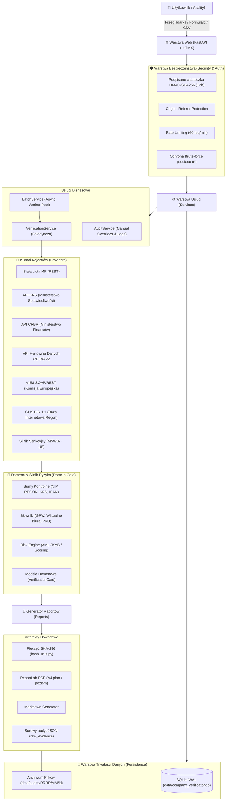

# 🏗️ Architektura Systemu CompanyVerificator

Niniejszy dokument przedstawia architekturę techniczną, przyjęte wzorce projektowe, organizację warstw kodu oraz przepływ danych w aplikacji **CompanyVerificator**.

---

## 🏛️ Filozofia projektowa

System został zaprojektowany w oparciu o zasady **Clean Architecture** oraz **Domain-Driven Design (DDD)** z zachowaniem zasady minimalizmu zależności zewnętrznych (KISS):
1. **Separacja odpowiedzialności:** Logika biznesowa oceny ryzyka ([`RiskEngine`](file:///home/acacko/PycharmProjects/CompanyVerificator/src/domain/risk_engine.py)) jest całkowicie odseparowana od klientów HTTP ([`providers`](file:///home/acacko/PycharmProjects/CompanyVerificator/src/providers)) oraz warstwy prezentacji ([`web`](file:///home/acacko/PycharmProjects/CompanyVerificator/src/web)).
2. **Determinizm dowodowy:** Każda weryfikacja operuje na niemutowalnej strukturze [`VerificationCard`](file:///home/acacko/PycharmProjects/CompanyVerificator/src/domain/models.py) i generuje kryptograficzny skrót SHA-256 z kanonicznego zrzutu JSON.
3. **Graceful degradation:** Chwilowa niedostępność jednego rejestru publicznego (np. okno serwisowe MF lub CEIDG) nie przerywa całej procedury; silnik oznacza brakujące źródła i adaptuje scoring.
4. **Wydajność bez bloatware:** Brak ciężkich frameworków SPA (React/Angular); zamiast tego nowoczesny stos **FastAPI + Jinja2 + HTMX + Alpine.js + TailwindCSS** zapewniający natychmiastowe ładowanie, reaktywność i zerowy czas budowania (brak node_modules w repozytorium).

---

## 📐 Diagram Architektury Przepływu Danych

---

## 🗂️ Struktura Modułów Kodu

Poniższa tabela przedstawia podział odpowiedzialności katalogów w katalogu [`src/`](file:///home/acacko/PycharmProjects/CompanyVerificator/src):

| Katalog | Rola w systemie | Główne pliki |
| :--- | :--- | :--- |
| **`src/core/`** | Niskopoziomowa warstwa fundamentowa: baza danych, bezpieczeństwo, walidatory. | [`database.py`](file:///home/acacko/PycharmProjects/CompanyVerificator/src/core/database.py), [`validators.py`](file:///home/acacko/PycharmProjects/CompanyVerificator/src/core/validators.py), [`security.py`](file:///home/acacko/PycharmProjects/CompanyVerificator/src/core/security.py), [`io.py`](file:///home/acacko/PycharmProjects/CompanyVerificator/src/core/io.py) |
| **`src/domain/`** | Czysta logika biznesowa: reguły AML, słowniki referencyjne, modele danych. | [`risk_engine.py`](file:///home/acacko/PycharmProjects/CompanyVerificator/src/domain/risk_engine.py), [`models.py`](file:///home/acacko/PycharmProjects/CompanyVerificator/src/domain/models.py), [`enums.py`](file:///home/acacko/PycharmProjects/CompanyVerificator/src/domain/enums.py), [`dictionaries/`](file:///home/acacko/PycharmProjects/CompanyVerificator/src/domain/dictionaries) |
| **`src/providers/`** | Asynchroniczni klienci API zewnętrznych instytucji rządowych i unijnych. | [`mf_white_list.py`](file:///home/acacko/PycharmProjects/CompanyVerificator/src/providers/mf_white_list.py), [`krs_client.py`](file:///home/acacko/PycharmProjects/CompanyVerificator/src/providers/krs_client.py), [`crbr_client.py`](file:///home/acacko/PycharmProjects/CompanyVerificator/src/providers/crbr_client.py), [`sanctions/`](file:///home/acacko/PycharmProjects/CompanyVerificator/src/providers/sanctions) |
| **`src/services/`** | Warstwa orkiestracji wieloetapowych procesów biznesowych i transakcji. | [`verification_service.py`](file:///home/acacko/PycharmProjects/CompanyVerificator/src/services/verification_service.py), [`batch_service.py`](file:///home/acacko/PycharmProjects/CompanyVerificator/src/services/batch_service.py), [`audit_service.py`](file:///home/acacko/PycharmProjects/CompanyVerificator/src/services/audit_service.py) |
| **`src/reports/`** | Silniki transformacji kart dowodowych do formatów raportowych. | [`pdf_generator.py`](file:///home/acacko/PycharmProjects/CompanyVerificator/src/reports/pdf_generator.py), [`markdown_generator.py`](file:///home/acacko/PycharmProjects/CompanyVerificator/src/reports/markdown_generator.py), [`hash_utils.py`](file:///home/acacko/PycharmProjects/CompanyVerificator/src/reports/hash_utils.py) |
| **`src/web/`** | Warstwa interfejsu użytkownika FastAPI (routing, szablony, middleware). | [`main.py`](file:///home/acacko/PycharmProjects/CompanyVerificator/src/main.py), [`routers/`](file:///home/acacko/PycharmProjects/CompanyVerificator/src/web/routers), [`templates/`](file:///home/acacko/PycharmProjects/CompanyVerificator/src/web/templates), [`dependencies.py`](file:///home/acacko/PycharmProjects/CompanyVerificator/src/web/dependencies.py) |

---

## ⚡ Cykl Życia Zapytania Weryfikacyjnego (Verification Lifecycle)

Gdy analityk lub system zewnętrzny zleca weryfikację podmiotu po identyfikatorze (np. NIP `5260251049`):

1. **Klasyfikacja wejścia:** [`classify_identifier()`](file:///home/acacko/PycharmProjects/CompanyVerificator/src/core/validators.py) rozpoznaje format (NIP, REGON, KRS, VAT-UE) i sprawdza matematyczną sumę kontrolną (modulo 11).
2. **Kwerenda równoległa (Async I/O):**
   - Równoległe odpytanie Białej Listy MF (`fetch_mf_white_list`) oraz CEIDG (`fetch_ceidg_info`).
   - Jeśli z Białej Listy pozyskano numer KRS -> równoległe pobranie odpisu KRS (`fetch_krs_odpis`) oraz beneficjentów CRBR (`fetch_crbr_beneficiaries`).
3. **Ekstrakcja i normalizacja:**
   - Wyciągnięcie reprezentacji zarządu, prokurentów, organów nadzorczych oraz beneficjentów UBO.
   - Identyfikacja statusu giełdowego ([`is_public_company`](file:///home/acacko/PycharmProjects/CompanyVerificator/src/domain/dictionaries/public_companies.py)).
4. **Analiza Sankcyjna:**
   - Przeszukanie bazy MSWiA i UE pod kątem NIP, KRS, pełnej nazwy podmiotu oraz nazwisk osób reprezentujących/UBO za pomocą tokenizacji i Levenshteina.
5. **Ewaluacja Silnika Ryzyka (Risk Engine):**
   - Zbadanie 10 reguł podatkowych i AML (m.in. staż, upadłość, zgodność rachunku z Białą Listą, kody PKD podwyższonego ryzyka, adres wirtualnego biura).
   - Obliczenie łącznego `risk_score` (0–100+) i przypisanie decyzji systemowej (`AKCEPTACJA`, `WYMAGA_WYJASNIENIA`, `WARUNKOWO`, `ODMOWA_WSPOLPRACY_STOP`).
6. **Kryptografia i Persystencja:**
   - Wyliczenie unikalnego identyfikatora UUIDv4 oraz sumy kontrolnej SHA-256.
   - Zapis rekordu do bazy SQLite w trybie WAL.
   - Zrzut plików fizycznych do archiwum dowodowego `data/audits/RRRR/MM/{id}/` (`.json`, `.md`, `.pdf`).
7. **Renderowanie HTMX:**
   - Odesłanie wyrenderowanego kafelka wyniku weryfikacji bez przeładowania strony.
