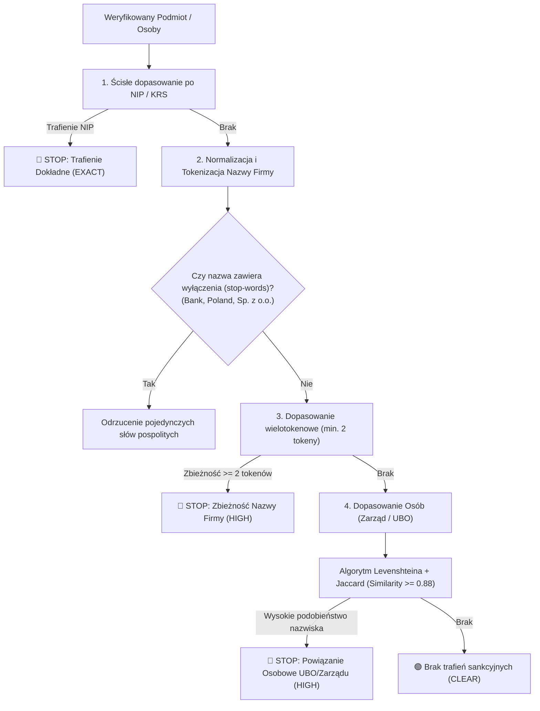

# 🔌 Rejestry Publiczne, Sankcje i Algorytmy Dopasowań

Dokument opisuje specyfikację integrowanych rejestrów państwowych, mechanizmy odporności na awarie oraz zaawansowane algorytmy dopasowywania sankcji w module [`src/providers/`](file:///home/acacko/PycharmProjects/CompanyVerificator/src/providers).

---

## 🏛️ Zintegrowane Rejestry Publiczne

| Rejestr | Instytucja Odpowiedzialna | Protokół / Źródło | Zakres Danych |
| :--- | :--- | :--- | :--- |
| **Biała Lista Podatników VAT** | Ministerstwo Finansów (KAS) | REST API (`wl-api.mf.gov.pl`) | Status rejestracji VAT, pełna nazwa, REGON, KRS, adres siedziby, numery rachunków rozliczeniowych, status kont wirtualnych, unikalny `requestId`. |
| **Krajowy Rejestr Sądowy (KRS)** | Ministerstwo Sprawiedliwości | Otwarty REST API (`api-krs.ms.gov.pl`) | Odpis aktualny (Dział 1: dane podmiotu, forma; Dział 2: reprezentacja, zarząd, prokurenci; Dział 3: kody PKD; Dział 6: likwidacja, upadłość, restrukturyzacja). |
| **Centralny Rejestr Beneficjentów Rzeczywistych (CRBR)** | Ministerstwo Finansów | Otwarty REST API (`crbr.podatki.gov.pl`) | Lista osób fizycznych sprawujących bezpośrednią lub pośrednią kontrolę (UBO) wraz ze stopniem udziału/uprawnień. |
| **Centralna Ewidencja Działalności Gospodarczej (CEIDG)** | Ministerstwo Rozwoju i Technologii | Hurtownia Danych CEIDG v2 (`dane.biznes.gov.pl`) | Status wpisu jednoosobowych działalności gospodarczych (aktywny, zawieszony, wykreślony), data rozpoczęcia, kody PKD. |
| **System VIES** | Komisja Europejska (DG TAXUD) | REST API (`ec.europa.eu`) | Ważność europejskiego numeru VAT-UE dla kontrahentów z krajów członkowskich UE. |
| **Baza Internetowa REGON (GUS BIR 1.1)** | Główny Urząd Statystyczny | SOAP Web Service (`stat.gov.pl`) | Dane statystyczne jednostek prawnych, w tym forma własności i data powstania. |
| **Lista Sankcyjna MSWiA** | Ministerstwo Spraw Wewnętrznych i Administracji | Parser HTML / Baza gov.pl | Podmioty i osoby fizyczne objęte sankcjami krajowymi na mocy ustawy z 13.04.2022 r. |
| **Unijna Lista Sankcyjna (EU Sanctions)** | Europejska Służba Działań Zewnętrznych (EEAS) | Parser XML FS-FSD | Globalna skonsolidowana lista sankcyjna Unii Europejskiej (zamrożenie aktywów). |

---

## 🛡️ Odporność na Błędy Przejściowe i Okna Serwisowe

System CompanyVerificator został zaprojektowany do stabilnej pracy ciągłej z uwzględnieniem specyfiki polskich API rządowych:

### 1. Błąd `WL-196` na Białej Liście MF
- **Zjawisko:** W godzinach nocnych i weekendowych Ministerstwo Finansów przeprowadza aktualizacje bazy danych, zwracając status HTTP 400 z ciałem:
  ```json
  {"code": "WL-196", "message": "Trwa aktualizacja bazy danych. Spróbuj ponownie później."}
  ```
- **Obsługa:** Moduł [`src/providers/mf_white_list.py`](file:///home/acacko/PycharmProjects/CompanyVerificator/src/providers/mf_white_list.py) rozpoznaje kod `WL-196` i realizuje retry z wykładniczym opóźnieniem (exponential backoff). Jeśli okno serwisowe trwa dłużej, podmiot otrzymuje flagę `MF_NIEDOSTEPNY_CHWILOWO`, co zapobiega błędnemu ukaraniu kontrahenta jako "niezarejestrowanego".

### 2. Sprawdzanie Kont Wirtualnych (Maski Rachunków)
- Standardowe wyszukiwanie kontrahenta na Białej Liście zwraca wyłącznie główne rachunki rozliczeniowe. Wiele dużych firm (np. operatorzy telekomunikacyjni, media, ubezpieczyciele) wystawia faktury z indywidualnymi subkontami masowymi (konta wirtualne).
- W przypadku braku bezpośredniego dopasowania numeru IBAN na liście głównej, system automatycznie odpytuje dedykowany endpoint:
  ```http
  GET /api/check/nip/{nip}/bank-account/{account}?date={date}
  ```
- Potwierdzenie powiązania przez MF (`accountAssigned = "TAK"`) kwalifikuje rachunek jako zweryfikowany pozytywnie (`ZGODNY_WIRTUALNY`).

---

## 🎯 Silnik Dopasowywania Sankcji (Matcher)

Weryfikacja sankcyjna w [`src/providers/sanctions/matcher.py`](file:///home/acacko/PycharmProjects/CompanyVerificator/src/providers/sanctions/matcher.py) odbywa się wielościeżkowo, eliminując zarówno ryzyko pominięcia (False Negative), jak i fałszywych alarmów na nazwach pospolitych (False Positive).

### Algorytm Dopasowania:



### Kluczowe reguły anty-False-Positive:
1. **Ograniczenie zbieżności pojedynczych słów:**
   - Pojedyncze słowa takie jak *"Bank"*, *"Invest"*, *"Poland"*, *"Trade"* nie mogą wywołać alarmu sankcyjnego (zapobiega to sytuacjom, w których polski bank, np. *Bank Handlowy*, byłby mylony z rosyjskim *T-Bank JSC*).
   - Dopasowanie częściowe wymaga zbieżności co najmniej **2 unikalnych tokenów** lub słowa unikalnego o długości **min. 8 znaków**.
2. **Normalizacja fonetyczna i transliteracja:**
   - Usunięcie znaków diakrytycznych, ujednolicenie form prawnych (`sp. z o.o.` -> `spzoo`), transliteracja cyrylicy (`Gazprom` / `Газпром`).
3. **Weryfikacja krzyżowa UBO:**
   - Badanie nazwisk beneficjentów rzeczywistych pobranych z rejestru CRBR oraz członków zarządu z KRS. W przypadku trafienia system wskazuje dokładną rolę powiązanej osoby.
