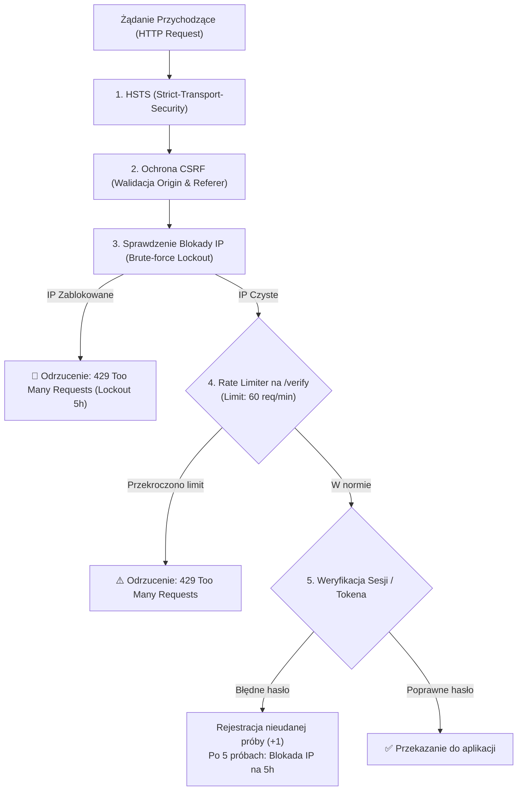

# 🔒 Bezpieczeństwo, Uwierzytelnianie i Integralność Danych

Niniejszy dokument przedstawia model bezpieczeństwa aplikacji **CompanyVerificator**, zabezpieczenia kryptograficzne kart audytowych, mechanizmy ochrony sesji oraz polityki ochrony przed atakami sieciowymi.

---

## 🛡️ Model Ochrony i Zabezpieczenia Kryptograficzne

Aplikacja przetwarza dane gospodarcze i generuje dokumentację stanowiącą dowód dochowania procedur należytej staranności przed organami skarbowymi (KAS). Z tego względu integralność danych jest priorytetem architektonicznym.

### 1. Pieczęć Dowodowa SHA-256 (Evidentiary Hash)
- Każda wygenerowana karta weryfikacyjna posiada unikalny podpis SHA-256 wyliczany z kanonicznego zrzutu danych:
  ```python
  canonical_payload = {
      "identifier": card.identifier,
      "nip": card.nip,
      "nazwa": card.nazwa,
      "data_weryfikacji": card.data_weryfikacji,
      "status_vat": card.status_vat,
      "mf_request_id": card.mf_request_id,
      "sankcje_trafienia": [t.to_dict() for t in card.sankcje_trafienia],
      "raw_evidence": card.raw_evidence,
  }
  sha256_hash = hashlib.sha256(json.dumps(canonical_payload, sort_keys=True).encode()).hexdigest()
  ```
- **Niezmienność po ingerencji analityka:** Pieczęć SHA-256 jest wyliczana z faktów pobranych z rejestrów. Późniejsze dodanie notatki lub zmiana statusu przez analityka nie unieważnia oryginalnego hasha źródłowego.

---

## 🔑 Uwierzytelnianie i Podpisane Ciasteczka HMAC-SHA256

Panel webowy jest zabezpieczony przed nieautoryzowanym dostępem za pomocą konfigurowalnego hasła w `.env` (`WEB_PASSWORD`).

### Mechanizm Sesyjny:
1. **Podpis kryptograficzny HMAC-SHA256:**
   - Ciasteczko sesyjne `cv_access_token` nie przechowuje hasła w postaci jawnej.
   - Token ma format: `<timestamp>.<salt>.<hmac_signature>`.
   - Podpis jest generowany przy użyciu klucza `WEB_PASSWORD` i losowej soli.
2. **Ograniczona ważność sesji (12 godzin):**
   - Każde żądanie weryfikuje timestamp tokena (`verify_session_token`).
   - Sesje starsze niż 12 godzin są automatycznie unieważniane, wymagając ponownego zalogowania.
3. **Flagi Bezpieczeństwa:**
   - `HttpOnly`: Uniemożliwia odczytanie ciasteczka przez JavaScript (ochrona przed XSS).
   - `SameSite=Lax`: Zabezpiecza przed atakami typu CSRF.
   - `Secure`: Automatycznie włączana przy połączeniach szyfrowanych HTTPS (`request.url.scheme == "https"` lub nagłówek `X-Forwarded-Proto: https`).

---

## 🚨 Ochrona Przed Atakami Sieciowymi

System implementuje wielopoziomowe mechanizmy obronne:



### Szczegóły Zabezpieczeń:
1. **Ochrona przed Brute-Force Logowania:**
   - Adres IP, z którego nastąpi 5 kolejnych nieudanych prób logowania, zostaje zablokowany na czas określony w `LOGIN_LOCKOUT_HOURS` (domyślnie 5 godzin).
   - Próby logowania z zablokowanego IP zwracają kod HTTP 429 wraz z nagłówkiem `Retry-After`.
2. **Ochrona CSRF (Cross-Site Request Forgery):**
   - Middleware weryfikuje nagłówki `Origin` i `Referer` dla wszystkich metod modyfikujących stan (`POST`, `PUT`, `DELETE`).
   - Żądania pochodzące z zewnętrznych domen są natychmiast odrzucane z kodem HTTP 403 Forbidden.
3. **Ochrona przed Open Redirect:**
   - Parametry przekierowania (`redirect_url`) są rygorystycznie sprawdzane pod kątem ścieżek relatywnych należących wyłącznie do bieżącej instancji aplikacji.
4. **Rate Limiting na weryfikacjach:**
   - W celu ochrony infrastruktury oraz limitów publicznych API rządowych, endpoint `/verify` jest objęty limitem 60 zapytań na minutę na adres IP klienta.
5. **Nagłówki Bezpieczeństwa (Security Headers):**
   - `Strict-Transport-Security: max-age=31536000; includeSubDomains` (dla ruchu HTTPS),
   - `X-Content-Type-Options: nosniff`,
   - `X-Frame-Options: DENY` (ochrona przed Clickjackingiem).
